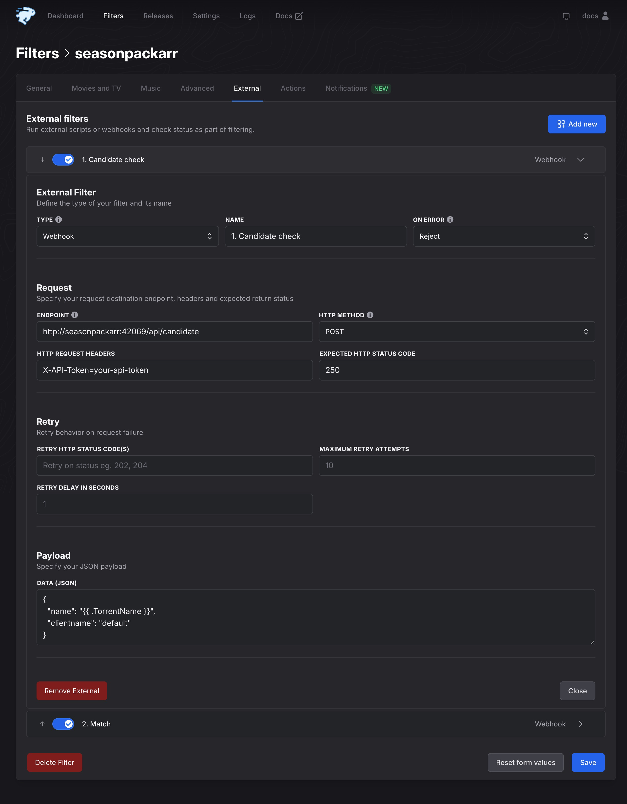
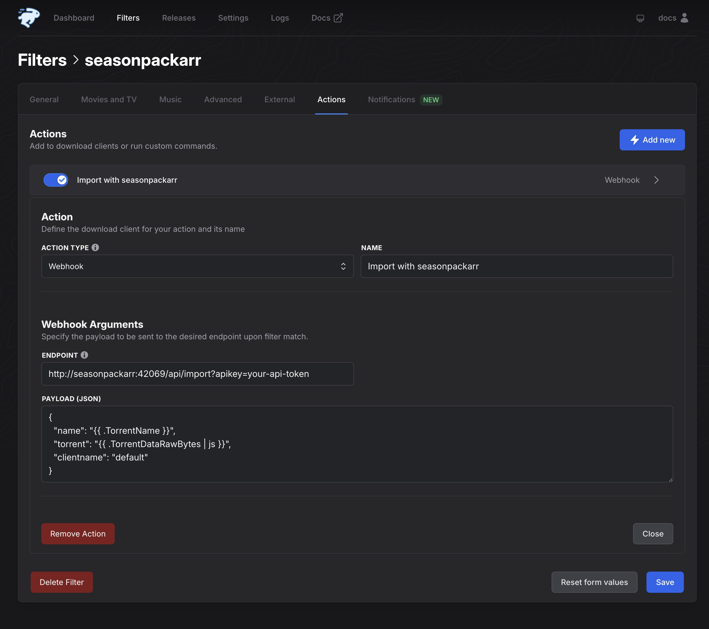

# autobrr setup

This guide sets up an autobrr filter that sends season pack announces to seasonpackarr. You need a running seasonpackarr
with at least one client, see [Install](INSTALL.md).

The filter does three things:

1. **Candidate check** (External entry 1): seasonpackarr checks the announce name. A rejection stops the filter before
   autobrr downloads the torrent file.
2. **Match** (External entry 2): seasonpackarr reads the torrent and the episode files on disk and makes an import plan.
   It changes no files and adds nothing to the client.
3. **Import** (the Webhook action): seasonpackarr hardlinks the reusable episodes and adds the season pack to the client.

There are two ways to set up the filter:

- [Set up the filter with the command](#set-up-the-filter-with-the-command): `seasonpackarr setup filter` writes the
  complete filter into autobrr. Use this way if you can.
- [Set up the filter by hand](#set-up-the-filter-by-hand): you copy each value into the autobrr web interface.

Both ways give the same checks and the same import action, with one filter for each seasonpackarr client.

## Set up the filter with the command

The command writes the filter through the autobrr REST API. It needs these inputs:

| Input | How to give it |
| --- | --- |
| The seasonpackarr URL that autobrr uses | `--webhook-url`, for example `http://seasonpackarr:42069` when both run in Docker |
| The autobrr URL | `SEASONPACKARR__AUTOBRR_URL` or `--autobrr-url` |
| An autobrr API key | `SEASONPACKARR__AUTOBRR_API_KEY` or `--autobrr-api-key`. Create the key in autobrr under **Settings**, **API keys** |
| The seasonpackarr API token and the client names | The command reads them from your config. Override them with `--api` and `--client` |

1. Run the command where it can read your seasonpackarr config, for example on the seasonpackarr host:

   ```sh
   export SEASONPACKARR__AUTOBRR_URL="http://autobrr:7474"
   export SEASONPACKARR__AUTOBRR_API_KEY="your-autobrr-api-key"
   seasonpackarr setup filter --webhook-url http://seasonpackarr:42069
   ```

   In Docker, run it in the seasonpackarr container. `-e` without a value copies the variable from your shell:

   ```sh
   docker exec -e SEASONPACKARR__AUTOBRR_URL -e SEASONPACKARR__AUTOBRR_API_KEY seasonpackarr \
     seasonpackarr setup filter --webhook-url http://seasonpackarr:42069
   ```

   The command creates one disabled filter named `seasonpackarr-<client>` for each client. Then autobrr sends a
   candidate check to seasonpackarr for each filter. This check shows that autobrr reaches seasonpackarr with the
   correct token and client name. If the check fails, the command names the cause, for example a wrong `--webhook-url`
   or token, and exits with `1`. The command writes the filter also when the check fails. Fix the cause and rerun the
   command with the `--filter-id` that it prints. autobrr versions earlier than v1.88.0 cannot run the check, so the
   command prints a warning and skips it.

2. In autobrr, do these steps for each new filter:
   1. Select the indexers in **General** > **Indexers**.
   2. In the **General** tab, set **Priority** higher than all your other TV filters, so that this filter runs first.
   3. Enable the filter.

The new filter accepts all resolutions. To accept only some resolutions, set them in the filter in autobrr. A later
update with the command keeps them.

To update a filter that you already have, for example a filter from v0.16.0, add `--filter-id <id>`. For all inputs,
the update, the check results, and the exit codes, see [Set up the autobrr filter](CLI.md#set-up-the-autobrr-filter).

## Set up the filter by hand

Create one filter for each seasonpackarr client.

In every value below:

- Replace `seasonpackarr:42069` with the host and port that autobrr uses to reach seasonpackarr.
- Replace `your-api-token` with the `apiToken` from your config.
- Replace `default` with your client name from the `clients` section of your config.

### Create the filter

1. In autobrr, open **Filters**, select the arrow next to **+ Create Filter**, then select **Import filter**.
2. Paste this JSON and select **Import**:

   ```json
   {
     "name": "arr-Seasonpackarr",
     "version": "1.0",
     "data": {
       "enabled": true,
       "seasons": "1-99",
       "episodes": "0",
       "resolutions": [
         "1080p",
         "1080i"
       ]
     }
   }
   ```

   This example accepts 1080p season packs. Change the resolutions to your needs, or remove them to accept all
   resolutions. The autobrr import keeps only these base filter settings. It does not keep indexers, External entries,
   or actions, so you add those by hand in the next steps.

3. In the **General** tab, open **Indexers** and select each tracker whose announces must go to seasonpackarr.
   autobrr runs a filter only for its selected indexers. A filter without indexers never runs, and autobrr shows no
   error. The filter list marks such a filter with **NO INDEXER**.
4. In the **General** tab, set **Priority** higher than all your other TV filters, so that this filter runs first. For
   example, if your Sonarr filter has priority `10` and a qBittorrent TV filter has `15`, set this filter to `16` or
   higher. A `cross-seed` filter can stay above it.

### Add the External checks

Open the filter's **External** tab. Add the two entries below. Make sure that each entry is enabled. autobrr v1.84.0
and earlier create new entries disabled.

#### Entry 1: candidate check

Select **Add new** and choose **Webhook**. Enter:

| Field | Value |
| --- | --- |
| Name | `1. Candidate check` |
| On Error | `Reject` |
| Endpoint | `http://seasonpackarr:42069/api/candidate` |
| HTTP method | `POST` |
| HTTP Request Headers | `X-API-Token=your-api-token` |
| Expected HTTP status code | `250` |

**Data (JSON)**:

```json
{
  "name": "{{ .TorrentName }}",
  "clientname": "default"
}
```



#### Entry 2: match

Select **Add new** again and choose **Webhook**. Enter:

| Field | Value |
| --- | --- |
| Name | `2. Match` |
| On Error | `Reject` |
| Endpoint | `http://seasonpackarr:42069/api/match` |
| HTTP method | `POST` |
| HTTP Request Headers | `X-API-Token=your-api-token` |
| Expected HTTP status code | `250` |

**Data (JSON)**, which includes the torrent:

```json
{
  "name": "{{ .TorrentName }}",
  "torrent": "{{ .TorrentDataRawBytes | js }}",
  "clientname": "default"
}
```

Use the same `clientname` in both entries. If you leave out `clientname`, seasonpackarr uses the client named `default`,
and the request fails when that client does not exist.

#### Check the order

autobrr runs the External entries from top to bottom. The candidate check must be first. Otherwise autobrr downloads
every torrent file before the cheap check can reject it.

1. Save the filter and reload the page.
2. Check that `1. Candidate check` is above `2. Match`.
3. If it is not, use the arrows beside the entries to move it up, then save and reload again. autobrr shows the arrows
   only when a filter has more than one External entry.

### API authentication

Use API authentication. Without `apiToken` in the config, anyone who can reach the port can import torrents.

1. Generate a token with `seasonpackarr gen-token` and set it as `apiToken` in the config.
2. In both External entries, set **HTTP Request Headers** to `X-API-Token=your-api-token`.
3. In the import action, add the token to the endpoint as `?apikey=your-api-token`. The autobrr Webhook action has no
   request header field, so the token goes in the query.

Without API authentication, leave the header empty and leave out `?apikey=...`.

### Add the import action

Open the filter's **Actions** tab. Select **Add new** and set **Action type** to `Webhook`. Enter:

| Field | Value |
| --- | --- |
| Name | `Import with seasonpackarr` |
| Endpoint | `http://seasonpackarr:42069/api/import?apikey=your-api-token` |

**Payload (JSON)**, with the same `clientname` as the External entries:

```json
{
  "name": "{{ .TorrentName }}",
  "torrent": "{{ .TorrentDataRawBytes | js }}",
  "clientname": "default"
}
```



This must be the only action of the filter. seasonpackarr adds the torrent to the client itself. A second action for a
torrent client would add the torrent a second time.

The save path, category, tags, and content layout come from the client's
[import policy](CONFIGURATION.md#import-policy) in the seasonpackarr config, not from autobrr.

Save and enable the filter.

## Multiple clients

Each filter sends announces to one seasonpackarr client. The command creates one filter for each client in your
config. By hand, create another filter for each additional client and use that client's name as `clientname` in all
three requests. For several Sonarr instances on one qBittorrent instance, see
[Use multiple Sonarr instances with one qBittorrent instance](CONFIGURATION.md#use-multiple-sonarr-instances-with-one-qbittorrent-instance).

To check a release by hand before you enable a filter, use the [command line](CLI.md). For the request and response
details of each endpoint, see [API](API.md).
