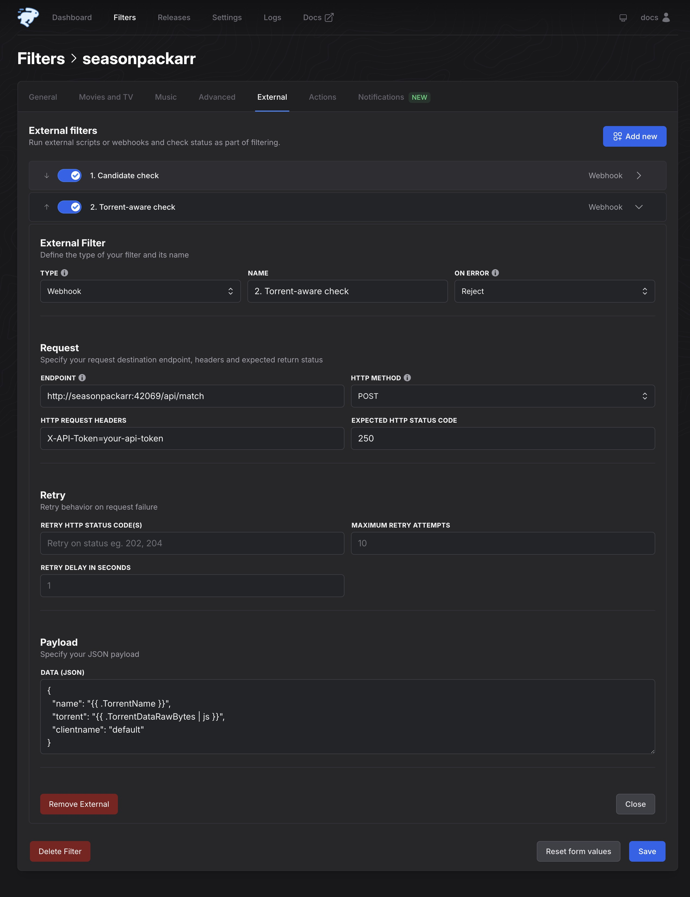
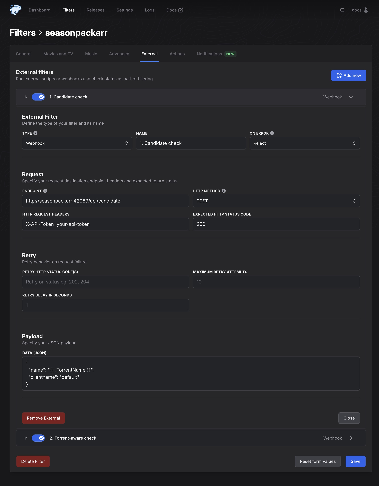
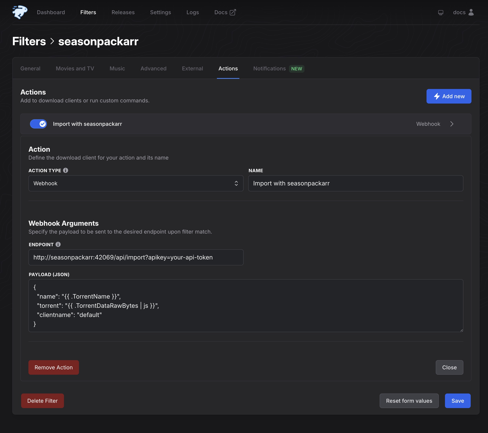

# Upgrade from v0.16.0 to v1.0.0

Use this guide to upgrade an existing seasonpackarr installation from v0.16.0 to
v1.0.0. For a new installation, start with the [README](../README.md).

The upgrade changes 2 things: your seasonpackarr configuration and your
seasonpackarr filter in autobrr. Plan a short maintenance window, and keep the
autobrr filter disabled until you complete step 5.

## What changes in v1.0.0

- **Torrent parsing is always on.** The `parseTorrentFile` setting is removed.
- **autobrr runs 2 checks.** The candidate check (`/api/candidate`) uses only the
  announce name, before autobrr downloads the torrent file. The match
  (`/api/match`) runs only when the candidate check passes. It reads the torrent
  and builds an import plan, but changes nothing.
- **seasonpackarr adds the torrent to the client.** The import (`/api/import`)
  creates the hardlinks and then adds the season pack to the torrent client.
  autobrr must not add the same torrent with a separate client action.
- **The old endpoints are removed.** `/api/pack` and `/api/parse` have no
  aliases.
- **Smart mode measures the torrent.** Coverage is the share of episode files in
  the torrent that seasonpackarr can reuse. Smart mode no longer asks TVDB or
  TVMaze for the episode count of the season. See
  [smart mode](CONFIGURATION.md#smart-mode).
- **Discord notifications change.**
  - The candidate check sends no notifications. In v0.16.0, `/api/pack` sent a
    notification for every result, so the `INFO` level reported each resolution,
    source, or group mismatch. These rejections are now silent.
  - An accepted season pack sends 2 `MATCH` notifications: one from the match
    and one from the import.
  - The notification action label is `Match` or `Import`. It was `Pack` before.
- **seasonpackarr creates a database.** v1.0.0 creates `seasonpackarr.db` at
  startup, also when you do not use Prowlarr. You do not install or configure a
  database. See [application data](INSTALL.md#application-data).

Existing torrent data does not move if the new import destination points to the
same location.

## 1. Back up

1. Disable the seasonpackarr filter in autobrr.
2. Export the filter, or take screenshots of its **External** and **Actions**
   tabs.
3. Open the old torrent-client action in autobrr. Write down its save path,
   category, tags, incomplete-download path, and content layout.
4. Write down the old `preImportPath` of each client in seasonpackarr.
5. Copy these files to a safe location:
   - `config.yaml`
   - your Docker Compose file and any `.env` file that it reads, if you use
     Docker
   - the complete config directory, if you want a full restore point
6. Write down the image tag or binary version that you run now.

> [!IMPORTANT]
> The example Compose file uses the image `ghcr.io/nuxencs/seasonpackarr`
> without a tag. That name gets v1.0.0 on the next pull. To stay on v0.16.0 until
> you finish this guide, set the image to
> `ghcr.io/nuxencs/seasonpackarr:v0.16.0`.

If the old `preImportPath` and the save path of the autobrr action are
different, decide which final destination the torrent client must use. v1.0.0
uses one destination for both the hardlinks and the imported torrent.

## 2. Update the configuration

### Remove old settings

Remove these settings from `config.yaml`, also when they are empty:

| Remove | Reason |
| --- | --- |
| `parseTorrentFile` | Torrent parsing is always on. |
| the complete `metadata` section | Smart mode no longer uses TVDB or TVMaze. |
| `clients.<name>.preImportPath` | The new `import` section replaces it. |

seasonpackarr does not start while one of these settings is present. If you use
Docker Compose or environment variables, also do the
[environment variable changes](#docker-compose-and-environment-variables).

### Add an import section for qBittorrent

Copy the values that you wrote down from the old autobrr qBittorrent action. For
example:

```yaml
clients:
  default:
    type: qbittorrent
    host: 127.0.0.1
    port: 8080
    username: admin
    password: change-me
    import:
      savePath: /data/torrents/tv-hd
      category: tv-hd
      tags: [seasonpackarr]
      # downloadPath: /data/torrents/incomplete
      # contentLayout: subfolder
```

A qBittorrent client needs `savePath`, `category`, or both:

- Use `savePath` to set the final folder directly.
- Use `category` when qBittorrent already selects the correct folder from the
  category and its Automatic Torrent Management settings.
- Use both when your current setup depends on both values.

> [!IMPORTANT]
> The category must already exist in qBittorrent. In v0.16.0, autobrr sent the
> category and qBittorrent created a missing category automatically. v1.0.0 does
> not create it. If the category is missing, the import fails with status `459`.
> seasonpackarr starts normally, so you see this error only at the first import.
> Create the category in qBittorrent before you enable the filter.

`tags` has no default value. If you omit it, the imported torrent gets no tag.
For all import settings, see [import policy](CONFIGURATION.md#import-policy).

### Add an import section for Transmission

Copy the save path and labels from the old autobrr Transmission action. For
example:

```yaml
clients:
  default:
    type: transmission
    host: 127.0.0.1
    port: 9091
    username: transmission
    password: change-me
    import:
      savePath: /data/torrents/tv-hd
      tags: [seasonpackarr]
```

If `savePath` is empty, seasonpackarr uses the default download folder of
Transmission. Transmission does not support `category`, `downloadPath`, or
`contentLayout`. seasonpackarr does not start when one of them is set on a
Transmission client.

### Settings from the old action that do not move

- The **Skip Hash Check** rule has no replacement. seasonpackarr controls the
  data check before it starts the torrent.
- A setting that left accepted torrents paused has no replacement.
  seasonpackarr adds the torrent so that the client checks only what it must,
  and then starts it.
- Move other client-specific rules to the defaults of the torrent client or to
  separate automation in the client.

### Check paths and permissions

Before you start v1.0.0, make sure that:

- The configured `savePath` exists.
- The configured `downloadPath` exists, if you set one. seasonpackarr does not
  start when `savePath` or `downloadPath` is missing. If you copy the
  incomplete-download path from the old autobrr action, seasonpackarr must also
  see that path.
- seasonpackarr can write to the target folder.
- seasonpackarr and the torrent client see the same data under compatible paths.
  In containers, the paths do not have to match the host paths. But
  seasonpackarr and the torrent client must agree on the path that the client
  receives.
- The existing episode files and the target folder are on the same filesystem.
  Hardlinks do not work across filesystems.
- The torrent-client account can add, check, and start torrents.
- The config directory is writable and on local storage, because v1.0.0 creates
  its database there. A read-only `/config` mount stops startup. See
  [application data](INSTALL.md#application-data).

### Docker Compose and environment variables

Do this step if you use Docker Compose or set `SEASONPACKARR__` environment
variables. seasonpackarr checks whether these variables exist, not their values.
It does not start while one of them is set, also when the value is empty or
`false`:

```text
SEASONPACKARR__PARSE_TORRENT_FILE
SEASONPACKARR__METADATA_TVDB_API_KEY
SEASONPACKARR__METADATA_TVDB_PIN
SEASONPACKARR__CLIENTS_<NAME>_PREIMPORTPATH
```

The v0.16.0 example Compose file sets `SEASONPACKARR__PARSE_TORRENT_FILE: false`
and an empty `SEASONPACKARR__CLIENTS_DEFAULT_PREIMPORTPATH`. Delete both lines.

To set the import section with environment variables, use these new variables:

```text
SEASONPACKARR__CLIENTS_<NAME>_IMPORT_SAVE_PATH
SEASONPACKARR__CLIENTS_<NAME>_IMPORT_CATEGORY
SEASONPACKARR__CLIENTS_<NAME>_IMPORT_TAGS
SEASONPACKARR__CLIENTS_<NAME>_IMPORT_DOWNLOAD_PATH
SEASONPACKARR__CLIENTS_<NAME>_IMPORT_CONTENT_LAYOUT
```

Replace `<NAME>` with the upper-case client name from your other variables, for
example `DEFAULT`. `IMPORT_TAGS` is a comma-separated list. Category, download
path, and content layout are qBittorrent-only settings.
`SEASONPACKARR__CLIENTS_<NAME>_TYPE` is not new. It works as in v0.16.0.

If you use Compose, run `docker compose config` and check the resolved
environment variables and volume paths.

## 3. Update the autobrr filter

The screenshots use autobrr 1.83.0. Other versions can look slightly different,
but the field names and values are the same. For the full filter setup, see the
[autobrr guide](AUTOBRR.md).

In each example:

- replace `seasonpackarr:42069` with the host and port that autobrr uses to reach
  seasonpackarr
- replace `your-api-token` with your seasonpackarr API token
- replace `default` with your seasonpackarr client name, if it is different

If API authentication is off (empty `apiToken`), leave the header empty and omit
`?apikey=...` from the action endpoint.

### Change the old `/api/pack` entry into the match

Your filter has one External entry for `/api/pack`. Open the filter's
**External** tab and do one of these:

- **Edit the entry.** Change the fields to the values below. The entry then
  stays above the candidate check that you add next, so you must
  [reorder the entries](#put-the-candidate-check-first).
- **Delete the entry and add it again** after the candidate check. Select
  **Add new** and choose **Webhook**.

| Field | Value |
| --- | --- |
| Name | `2. Match` |
| On Error | `Reject` |
| Endpoint | `http://seasonpackarr:42069/api/match` |
| HTTP method | `POST` |
| HTTP Request Headers | `X-API-Token=your-api-token` |
| Expected HTTP status code | `250` |

**Data (JSON)** must now include the `torrent` field:

```json
{
  "name": "{{ .TorrentName }}",
  "torrent": "{{ .TorrentDataRawBytes | js }}",
  "clientname": "default"
}
```

Enable the entry. autobrr downloads the torrent file for this check only after
the candidate check passes.



### Add the candidate check

In the **External** tab, select **Add new** and choose **Webhook**. Enter:

| Field | Value |
| --- | --- |
| Name | `1. Candidate check` |
| On Error | `Reject` |
| Endpoint | `http://seasonpackarr:42069/api/candidate` |
| HTTP method | `POST` |
| HTTP Request Headers | `X-API-Token=your-api-token` |
| Expected HTTP status code | `250` |

Use this in **Data (JSON)**:

```json
{
  "name": "{{ .TorrentName }}",
  "clientname": "default"
}
```

Enable the entry.



### Put the candidate check first

autobrr runs the External entries from top to bottom. The order must be:

1. `1. Candidate check`
2. `2. Match`

autobrr shows the reorder arrows only when the filter has more than one External
entry. Use the arrows if necessary. Save the filter, reload the page, and make
sure that the candidate check is still first.

### Replace the old actions with the import action

Open the filter's **Actions** tab.

1. Delete the old qBittorrent or Transmission action. seasonpackarr now adds the
   torrent itself. If the old action stays, the torrent can be added twice.
2. If the filter has a Webhook action for `/api/parse`, change its endpoint to
   `/api/import`. Otherwise, select **Add new** and set **Action type** to
   `Webhook`.
3. Make sure that this Webhook is the only action that adds or sends the
   torrent.

| Field | Value |
| --- | --- |
| Action type | `Webhook` |
| Name | `Import with seasonpackarr` |
| Endpoint with API authentication | `http://seasonpackarr:42069/api/import?apikey=your-api-token` |
| Endpoint without API authentication | `http://seasonpackarr:42069/api/import` |

Use this in **Payload (JSON)**:

```json
{
  "name": "{{ .TorrentName }}",
  "torrent": "{{ .TorrentDataRawBytes | js }}",
  "clientname": "default"
}
```

The autobrr Webhook action has no request-header field. With API
authentication, put the token in the endpoint as shown above.



Save the filter, but keep it disabled until v1.0.0 runs.

## 4. Update scripts that use the CLI

Skip this step if you do not run seasonpackarr commands yourself.

v1.0.0 removes the `test` command group, with `test pack` and `test parse`. Use
the new command for your task:

| v0.16.0 command | v1.0.0 command |
| --- | --- |
| `test pack "<release>"` | `seasonpackarr candidate "<release>"` |
| `test pack "<release>"` with `parseTorrentFile: false` | `seasonpackarr import <file.torrent>` |
| `test parse <file.torrent>` | `seasonpackarr import <file.torrent>` |
| none (check reuse, change nothing) | `seasonpackarr match <file.torrent>` |

With `parseTorrentFile: false`, `test pack` created hardlinks. In v1.0.0, only
`import` creates hardlinks. `import` needs the `.torrent` file, and it also adds
the torrent to the client. To check a torrent without these changes, use
`match`.

`match` and `import` need a real `.torrent` file. A release name no longer
creates a mock torrent. The command reads the release name from the torrent
contents, so the file name does not have to match. If the folder name inside the
torrent does not have the full release name, add
`--release "<full-tracker-release-name>"`. See
[torrents with a short folder name](CLI.md#torrents-with-a-short-folder-name).

Changes for scripts:

- The commands read connection settings from your config and environment. The
  `--host`, `--port`, and `--api` flags still override them. Add
  `--config <directory>` for a custom config directory, and `--client <name>`
  when you have more than one client.
- Results are text by default. Add `--json` for structured results.
- Exit code `0` means accepted. Exit code `1` means an input, configuration,
  connection, authentication, or operation failure. Exit code `2` means that the
  candidate check, match, or import rejected the season pack.
- Errors that printed a message and returned `0` in v0.16.0 now return a
  nonzero exit code. Results go to stdout. Diagnostics go to stderr.
- `version` prints local build information. It no longer checks GitHub for the
  latest release.

For all commands, including the new `search` command, see the
[CLI guide](CLI.md).

## 5. Start v1.0.0 and check the setup

1. Install the v1.0.0 binary, or set the image tag to `v1.0.0` and pull it.
2. Start seasonpackarr. Keep the autobrr filter disabled.
3. Read the seasonpackarr log:
   - If it reports a deprecated setting or environment variable, remove it and
     start again.
   - If it reports a missing `savePath` or `downloadPath`, fix the path and
     start again.
   - If it reports a database error, check the permissions, the volume mount,
     and the free space of the config directory.
   - At the `INFO` level, look for `database ready`.
4. Open `http://seasonpackarr:42069/api/healthz/readiness`. A ready service
   returns `OK`.
5. Optional: check one release name and one torrent file from the command line.
   Neither command changes files or the client.

   ```bash
   seasonpackarr candidate "Series.S01.1080p.WEB-DL.H.264-RlsGrp" --client default
   seasonpackarr match "/path/to/Series.S01.torrent" --client default
   ```

   Do not use `import` as a test. It creates hardlinks and adds the torrent.
6. Reload the autobrr filter and make sure that the candidate check is first.
7. Enable the filter.
8. Watch the first accepted season pack. Make sure that:
   - autobrr runs the candidate check first and the match second
   - the client gets only one torrent
   - existing episodes appear as hardlinks in the season pack folder
   - the torrent finishes its check and starts
   - only missing data downloads

Do not send the same season pack again while the torrent client still checks it.

## Roll back to v0.16.0

1. Disable the autobrr filter.
2. Stop v1.0.0.
3. Install the v0.16.0 binary, or set the image to
   `ghcr.io/nuxencs/seasonpackarr:v0.16.0`. An image without a tag starts
   v1.0.0 again.
4. Restore your backed-up v0.16.0 `config.yaml`, Compose file, and `.env` file.
   They contain the old settings, such as `parseTorrentFile` and
   `preImportPath`, that v0.16.0 needs.
5. Restore the old autobrr filter: the single `/api/pack` External entry and the
   old torrent-client action. If the old configuration uses
   `parseTorrentFile: true`, also restore the `/api/parse` Webhook action above
   the torrent-client action.
6. Start v0.16.0, make sure it is healthy, and enable the filter.

Rollback does not remove hardlinks or torrents that v1.0.0 already imported.
Check them before the restored filter processes the next announce. v0.16.0 does
not use `seasonpackarr.db`. Keep the file for a later upgrade.

## Troubleshooting

### seasonpackarr does not start after the upgrade

Read the first error in the log:

- **`deprecated config detected`**: remove the named key from `config.yaml`. See
  [remove old settings](#remove-old-settings).
- **`deprecated environment variable detected`**: remove the named variable from
  your Compose file or environment, also when its value is empty or `false`. See
  [Docker Compose and environment variables](#docker-compose-and-environment-variables).
- **`import.savePath ... doesn't exist`** or
  **`import.downloadPath ... doesn't exist`**: create the folder, or correct the
  path so that seasonpackarr can see it.

### The import fails with status 459

The log shows `qbit category "<name>" was not found in qbittorrent`. Create the
category in qBittorrent, or correct `import.category`. Then send the season pack
again.

### The import action times out in autobrr

autobrr waits 120 seconds for a Webhook action. The import does not wait for the
data check of the torrent client, so a normal import finishes in seconds. A
timeout points to a slow or unreachable torrent client or filesystem.

A timeout in autobrr does not always mean that the import stopped. seasonpackarr
finishes a started client import also after autobrr disconnects. Before you send
the season pack again:

1. Read the seasonpackarr log.
2. Check whether the torrent is already in the client.

## Other changes in v1.0.0

These changes need no action during the upgrade:

- **Prowlarr discovery**: RSS monitoring and search can find season packs
  without autobrr. Both are optional, and RSS monitoring is off by default. See
  the [Prowlarr guide](PROWLARR.md).
- **Deluge**: v1.0.0 supports Deluge 1.3 and Deluge 2. See
  [Deluge](CONFIGURATION.md#deluge).
- **Config reload**: seasonpackarr now validates each configuration change and
  keeps the last valid configuration when an edit is invalid. Changes to client
  and Prowlarr connections now apply without a restart. See
  [config reload](CONFIGURATION.md#config-reload).
- **Smart mode**: review the first few results after the upgrade. Partial
  season packs, specials, and unusual file layouts can give a different result
  than in v0.16.0. See [smart mode](CONFIGURATION.md#smart-mode).
